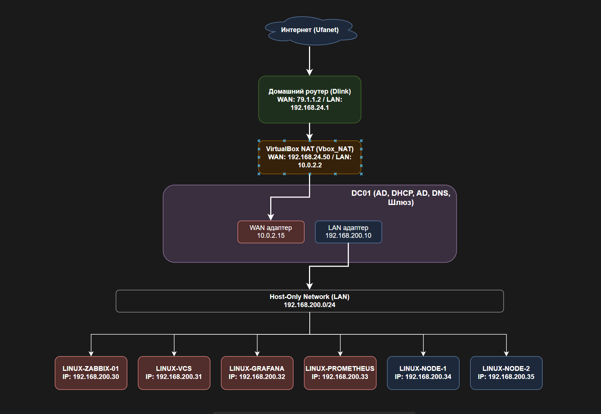

# windows-infra-lab

Данный репозиторий содержит руководство по созданию лабораторной среды на базе Windows Server. Сервер **DC01** выполняет роль шлюза между внешней сетью (WAN) и изолированной внутренней сетью (LAN), а также предоставляет основные инфраструктурные сервисы: Active Directory, DNS, DHCP и маршрутизацию (NAT).



## 1. Требования и подготовка

*   **ОС:** Windows Server 2019 / 2022 / 2025 (Desktop Experience).
*   **Сетевые адаптеры:** Минимум два (WAN и LAN).
*   **Имя сервера:** `DC01`.
*   **Особенности настройки сети:**
    *   **LAN-адаптер** (Host-Only) настраивается сразу: `192.168.200.10`, маска `255.255.255.0`, шлюз **пустой** (сервер сам является шлюзом для этой сети), DNS: `127.0.0.1` (или `192.168.200.10`).
    *   **WAN-адаптер** (NAT) изначально **отключен** в настройках виртуальной машины. Он будет добавлен/включен позже, на этапе настройки RRAS. Адрес получается по DHCP от виртуального NAT адаптера в VirtualBox (стабильно `10.0.2.15`, шлюз `10.0.2.2`). Это делается специально, чтобы избежать конфликтов DNS при повышении сервера до контроллера домена.

---

## 2. Установка и настройка Active Directory Domain Services (AD DS)

### 2.1. Установка роли
**Вариант A: Графический интерфейс**
1.  Откройте **Диспетчер сервера** → **Управление** → **Добавить роли и компоненты**.
2.  Выберите **Установка на основе ролей или компонентов**.
3.  На странице **Роли сервера** отметьте **Active Directory Domain Services** (при запросе согласитесь добавить компоненты).
4.  Нажмите **Установить**.

**Вариант B: PowerShell**
```powershell
Install-WindowsFeature -Name AD-Domain-Services -IncludeManagementTools
```

### 2.2. Повышение до контроллера домена
*(На этом этапе WAN-адаптер должен быть выключен/отсутствовать)*.

**Графический интерфейс:**
1.  В **Диспетчере сервера** нажмите на флажок уведомлений (жёлтый треугольник) → **Повысить этот сервер до контроллера домена**.
2.  Выберите **Добавить новый лес**.
3.  Укажите **Имя корневого домена**, например: `lab.local`.
4.  Задайте **пароль режима восстановления служб каталогов (DSRM)** и сохраните его.
5.  Пройдите мастер до конца и нажмите **Установить**. Сервер перезагрузится автоматически.

**PowerShell:**
```powershell
# Повышение до контроллера домена (пример для домена lab.local)
$pass = "Qq123456" | ConvertTo-SecureString -AsPlainText -Force
Install-ADDSForest -DomainName "lab.local" -InstallDns -SafeModeAdministratorPassword $pass -Force
```
> **Важно:** После перезагрузки входите в систему под учётной записью `LAB\Administrator`.

---

## 3. Настройка DNS Server

*Роль DNS-сервера обычно устанавливается автоматически вместе с AD DS, так как контроллер домена требует наличия DNS. Если по какой-то причине она не установилась, установите её через Диспетчер сервера.*

### 3.1. Настройка пересылки (Forwarders)
Для разрешения внешних имён (например, `google.com`) настройте пересылку на публичные DNS-серверы:
*   **Графически:** Откройте **DNS Manager** → правой кнопкой по имени сервера → **Свойства** → вкладка **Пересылка (Forwarders)** → добавьте `8.8.8.8` и `1.1.1.1`.
*   **PowerShell:**
    ```powershell
    Add-DnsServerForwarder -IPAddress "8.8.8.8", "1.1.1.1"
    ```

### 3.2. Создание обратной зоны (Reverse Lookup Zone)
Для корректной работы DHCP и разрешения IP-адресов в имена:
```powershell
Add-DnsServerPrimaryZone -NetworkID "192.168.200.0/24" -ReplicationScope Forest
```

### 3.3. Проверка
```powershell
nslookup google.com
nslookup 192.168.200.10
```

---

## 4. Установка и настройка DHCP Server

### 4.1. Установка роли
**Вариант A: Графический интерфейс**
1.  Откройте **Диспетчер сервера** → **Управление** → **Добавить роли и компоненты**.
2.  На странице **Роли сервера** отметьте **DHCP Server** (при запросе согласитесь добавить компоненты и завершите установку).

**Вариант B: PowerShell**
```powershell
Install-WindowsFeature -Name DHCP -IncludeManagementTools
```

### 4.2. Авторизация в AD
DHCP-сервер должен быть авторизован в Active Directory, чтобы выдавать адреса клиентам домена.
*   **Графически:** В **Диспетчере сервера** → **Средства** → **DHCP** → правой кнопкой по серверу → **Авторизовать**.
*   **PowerShell:**
    ```powershell
    Add-DhcpServerInDC -DnsName "dc01.lab.local" -IPAddress 192.168.200.10
    ```

### 4.3. Создание области (Scope)
Создайте пул адресов для клиентов, исключив адрес самого сервера и шлюза:
```powershell
# Исключаем адрес DC01 (192.168.200.10) и возможные статические адреса
Add-DhcpServerv4Scope -Name "LAN_Clients" `
    -StartRange 192.168.200.30 `
    -EndRange 192.168.200.254 `
    -SubnetMask 255.255.255.0 `
    -State Active

# Настраиваем параметры области: шлюз (DC01) и DNS (DC01)
Set-DhcpServerv4OptionValue -ScopeId 192.168.200.0 `
    -Router 192.168.200.10 `
    -DnsServer 192.168.200.10 `
    -DnsDomain "lab.local"
```

---

## 5. Установка и настройка RRAS (Маршрутизация и NAT)

RRAS (Routing and Remote Access Service) превращает Windows Server в программный маршрутизатор с поддержкой NAT.

**Шаг 0: Добавление WAN-адаптера**
Теперь, когда AD, DNS и DHCP настроены, зайдите в настройки виртуальной машины в VirtualBox, **включите второй сетевой адаптер** (тип подключения: **NAT**) и запустите ВМ. Адаптер получит IP по DHCP (ожидаемо `10.0.2.15` со шлюзом `10.0.2.2`).

### 5.1. Установка роли
**Вариант A: Графический интерфейс**
1.  Откройте **Диспетчер сервера** → **Управление** → **Добавить роли и компоненты**.
2.  На странице **Роли сервера** отметьте **Remote Access**.
3.  В разделе **Remote Access** → **Role Services** выберите **Routing**.
4.  Завершите установку.

**Вариант B: PowerShell**
```powershell
Install-WindowsFeature -Name RemoteAccess, Routing -IncludeManagementTools
```

### 5.2. Первичная настройка
*   **Графически:** Откройте **Диспетчер сервера** → **Средства** → **Маршрутизация и удалённый доступ (RRAS)**.
    *   Правой кнопкой по имени сервера → **Настроить и включить маршрутизацию и удалённый доступ**.
    *   Выберите **Особая конфигурация (Custom configuration)**.
    *   Отметьте **NAT** и **Маршрутизация локальной сети (LAN routing)**.
    *   Завершите мастер и при запросе запустите службу.
*   **PowerShell (альтернатива):**
    ```powershell
    # Включение маршрутизации
    Install-RemoteAccess -VPNType RoutingOnly
    ```

### 5.3. Настройка NAT-интерфейсов
В консоли **RRAS**:
1.  Разверните узел **IPv4** → правой кнопкой по **NAT** → **Новый интерфейс**.
2.  Выберите **WAN-адаптер** (тот, что смотрит в сеть `10.0.2.0/24`):
    *   Тип: **Общедоступный интерфейс, подключенный к Интернету**.
    *   Отметьте **Включить NAT на этом интерфейсе**.
3.  Снова **Новый интерфейс** → выберите **LAN-адаптер** (сеть `192.168.200.0/24`):
    *   Тип: **Частный интерфейс** (только для внутренней сети).

### 5.4. Включение пересылки IP-пакетов (Forwarding)
Windows по умолчанию может блокировать пересылку. Включите её для обоих интерфейсов.
*Узнать точные имена интерфейсов можно командой `Get-NetAdapter`.*
```powershell
Set-NetIPInterface -Forwarding Enabled -InterfaceAlias "Ethernet", "Ethernet 2"
```
> *Замените `"Ethernet"` и `"Ethernet 2"` на фактические имена ваших сетевых подключений.*

### 5.5. Проверка правил брандмауэра
Убедитесь, что правила для маршрутизации активны:
```powershell
Get-NetFirewallRule -DisplayGroup *routing* | Enable-NetFirewallRule
```

---

## 6. Проверка работоспособности

1.  **Проверка DHCP:** Подключите тестовый клиент (или виртуальную машину) к сети `Host-Only` и убедитесь, что он получил IP из диапазона `192.168.200.30 – 254`, шлюз `192.168.200.10` и DNS `192.168.200.10`.
2.  **Проверка DNS:** С клиента выполните `nslookup google.com` – должен вернуться IP-адрес.
3.  **Проверка NAT (выход в интернет):** С клиента выполните `ping 8.8.8.8` (или `ping google.com`).
4.  **Проверка маршрутизации между сетями:** С DC01 выполните `ping 10.0.2.2` (шлюз провайдера) и `ping 192.168.200.30` (любой клиент).

---

## 7. Примечания и рекомендации

*   **Особенность NAT в VirtualBox:** Несмотря на то, что WAN-адаптер получает адрес по DHCP, в среде VirtualBox NAT адрес `10.0.2.15` закрепляется за виртуальной машиной намертво (пока не изменится MAC-адрес). Это делает схему полностью рабочей и стабильной для лабораторных целей.
*   **Безопасность:** В лабораторной среде допустимо использовать простые пароли, но в реальной инфраструктуре используйте сложные пароли и регулярно меняйте их.
*   **Резервное копирование:** После настройки всех ролей рекомендуется создать снимок (snapshot) виртуальной машины DC01.
*   **Дополнительные сервисы:** Клиентские серверы (Zabbix, Grafana, VMBitrix и др.) могут быть настроены как отдельные виртуальные машины с статическими IP-адресами из диапазона `192.168.200.30–35`, как показано на схеме.
